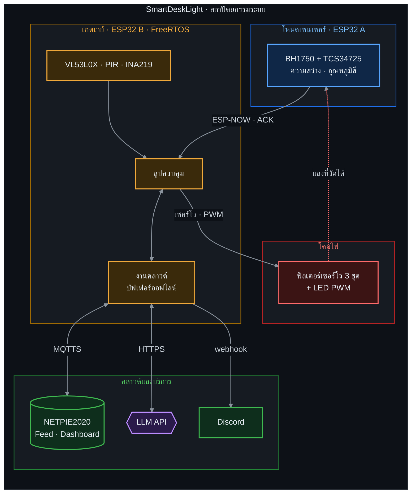

<div align="center">

# 💡 SmartDeskLight

### โคมไฟโต๊ะอัจฉริยะ ปรับแสงตามการทำงานของคุณ

โคมไฟโต๊ะที่มี AI ช่วยเลือกสภาพแสง ปรับลักษณะแสงด้วยฟิลเตอร์ที่ขับด้วยเซอร์โว<br>และควบคุมแบบวงปิดจากค่าความสว่าง (lux) ที่ตกถึงโต๊ะจริง

<br>

[](https://github.com/E3-Embed/SmartDeskLight/actions/workflows/build.yml)


[](LICENSE)

**[สถาปัตยกรรม](#สถาปัตยกรรม)** · **[ลำดับการทำงาน](#ลำดับการทำงาน)** · **[หลักการทำงาน](#หลักการทำงาน)** · **[เริ่มต้นใช้งาน](#เริ่มต้นใช้งาน)** · **[เอกสาร](#เอกสาร)** · **[ทีม](#ทีม)**

</div>

<br>

## สถาปัตยกรรม



<sub>ไดอะแกรมแบบละเอียดพร้อมงาน FreeRTOS และหัวข้อ E: [`docs/architecture.png`](docs/architecture.png)</sub>

## ลำดับการทำงาน

การทำงานหนึ่งรอบของระบบ ตั้งแต่การวัดค่าจนถึงแสงบนโต๊ะที่ตรวจสอบแล้ว:

```mermaid
%%{init: {"theme": "base", "themeVariables": {"background": "#0D1117", "actorBkg": "#161B22", "actorBorder": "#58A6FF", "actorTextColor": "#E6EDF3", "actorLineColor": "#30363D", "signalColor": "#8B949E", "signalTextColor": "#E6EDF3", "labelBoxBkgColor": "#161B22", "labelBoxBorderColor": "#30363D", "labelTextColor": "#E6EDF3", "loopTextColor": "#C9D1D9", "noteBkgColor": "#1F2A37", "noteBorderColor": "#30363D", "noteTextColor": "#C9D1D9", "activationBkgColor": "#3A2A0B", "activationBorderColor": "#F0A93B", "sequenceNumberColor": "#0D1117"}, "sequence": {"mirrorActors": false, "boxMargin": 8, "messageMargin": 38, "noteMargin": 10}}}%%
sequenceDiagram
  autonumber
  actor U as ผู้ใช้
  participant N as โหนดเซนเซอร์
  participant G as เกตเวย์
  participant L as โคมไฟ
  participant A as LLM API
  participant P as NETPIE2020

  rect rgb(18, 23, 30)
    Note over N,G: ตรวจวัด — ทุกวินาที
    N->>G: Telemetry { node_id, seq, lux, cct }
    G-->>N: ACK { seq }
    opt ไม่ได้รับ ACK ภายใน 100 ms
      N->>G: ส่งซ้ำ (สูงสุด 3 ครั้ง)
    end
    G->>P: MQTTS publish (ข้อมูลดิบ + shadow)
  end

  rect rgb(22, 27, 34)
    Note over U,P: ตัดสินใจ — เมื่อเปลี่ยนกิจกรรม มี feedback หรือทุก 5 นาที
    U->>P: เลือกกิจกรรม / "สว่างเกินไป"
    P->>G: @msg/sdl/cmd
    activate G
    G->>A: HTTPS ส่งบริบท (lux, cct, presence, feedback)
    A-->>G: { target_lux, target_cct, filters[3] }
    G->>G: จำกัดช่วงค่า และจำกัดความถี่การขยับเซอร์โว
    deactivate G
  end

  rect rgb(18, 23, 30)
    Note over N,L: สั่งงานและตรวจสอบ — วงปิด
    G->>L: มุมเซอร์โว + PWM
    L-->>N: แสงที่ตกบนโต๊ะ
    N->>G: ค่า lux ใหม่
    alt ค่าคลาดเคลื่อนอยู่ในเกณฑ์
      G->>G: คงค่าเดิม
    else ยังไม่ถึงค่าเป้าหมาย
      G->>L: ปรับ PWM อย่างละเอียด
    end
  end

  rect rgb(22, 27, 34)
    Note over G,P: การรับมือเมื่อเกิดปัญหา
    alt เชื่อมต่อคลาวด์ไม่ได้
      G->>G: เก็บข้อมูลในบัฟเฟอร์ แล้วส่งต่อเมื่อเชื่อมต่อได้
    else กดปุ่มหยุด หรือเซนเซอร์ขัดข้อง
      G->>L: สถานะปลอดภัย (พับฟิลเตอร์ออก, LED ระดับกลาง)
      G->>P: แจ้งเตือน → Discord
    end
  end
```



## จุดเด่น

- **ปรับลักษณะแสง ไม่ใช่แค่ความสว่าง** — ฟิลเตอร์ diffuser, ND และ warm/CTO พับเข้า-ออกด้วยเซอร์โว 3 ตัว
- **ควบคุมแบบวงปิด** — ทุกการเปลี่ยนแปลงถูกวัดซ้ำบนโต๊ะ (BH1750 วัด lux, TCS34725 วัดสี)
- **เรียนรู้ความชอบของผู้ใช้** — LLM เสนอโปรไฟล์แสงตามกิจกรรม และปรับตาม feedback *สว่างเกินไป / มืดเกินไป*
- **ออกแบบให้ทำงานต่อได้เสมอ** — ESP-NOW พร้อม ACK/ส่งซ้ำ, เก็บข้อมูลไว้ส่งทีหลังเมื่อออฟไลน์, มีโปรไฟล์ตามกฎสำรองเมื่อ AI ใช้ไม่ได้

## หลักการทำงาน

| | ขั้นตอน | สิ่งที่เกิดขึ้น |
|:-:|---|---|
| 1 | **ตรวจวัด** | โหนดเซนเซอร์วัดความสว่างและสีบนโต๊ะ ส่วนเกตเวย์อ่านค่าการมีคนอยู่ ระยะห่าง และกำลังไฟของโคม |
| 2 | **ตัดสินใจ** | เกตเวย์ส่งบริบทให้ AI แล้วได้ค่าเป้าหมาย lux อุณหภูมิสี และชุดฟิลเตอร์กลับมา |
| 3 | **สั่งงาน** | งานควบคุมใน FreeRTOS ขยับเซอร์โวฟิลเตอร์และปรับ LED ด้วย PWM |
| 4 | **ตรวจสอบ** | วัดแสงใหม่อีกครั้ง แล้วลูปควบคุมแก้ค่าคลาดเคลื่อนที่เหลือ |

## เริ่มต้นใช้งาน

```bash
git clone https://github.com/E3-Embed/SmartDeskLight.git && cd SmartDeskLight
cp firmware/gateway/include/secrets.example.h firmware/gateway/include/secrets.h   # ใส่คีย์ของคุณ
pio run -d firmware/gateway -t upload
pio run -d firmware/sensor_node -t upload
```

ต้องมี [PlatformIO](https://platformio.org/), บอร์ด ESP32 สองบอร์ด และ device บน NETPIE2020 — ดูรายละเอียดในเอกสารด้านล่าง

## เอกสาร

| เอกสาร | เนื้อหา |
|---|---|
| [ฮาร์ดแวร์](docs/hardware.md) | รายการอุปกรณ์ ผังขา ไฟเลี้ยง และความปลอดภัย |
| [โปรโตคอล](docs/protocols.md) | แพ็กเก็ต ESP-NOW, topic ของ NETPIE, คำขอและคำตอบของ AI |
| [เฟิร์มแวร์](docs/firmware.md) | งาน FreeRTOS และหัวข้อ Embedded Engineering Depth |
| [การทดสอบ](docs/testing.md) | ตัวชี้วัด วิธีทดสอบ และผลลัพธ์ |
| [แดชบอร์ด](dashboard/README.md) | การตั้งค่า device, dashboard และการแจ้งเตือนบน NETPIE2020 |
| [แนวทางการร่วมพัฒนา](CONTRIBUTING.md) | การตั้งชื่อ branch รูปแบบ commit และนโยบายข้อมูลลับ |

## ทีม

| สมาชิก | บทบาท |
|---|---|
| **รชาทัช บุญพัฒน์** · 6833230421 | สถาปนิกระบบและผู้รวมระบบ |
| **ฐากูร นันตสุวรรณ** · 6833060021 | นักพัฒนาระบบฝังตัว — โหนดเซนเซอร์ |
| **นรินธร ยางงาม** · 6833136121 | นักพัฒนาระบบฝังตัว — เกตเวย์และคลาวด์ |
| **ปุณยวีร์ พัฒนประดิษฐ์** · 6833170421 | นักพัฒนา UI/UX และแดชบอร์ด |
| **กษิดิศ ประจงการ** · 6833008521 | ผู้จัดการโครงการและหัวหน้าฝ่ายทดสอบ |

## สถานะ

- [x] ข้อเสนอโครงงาน สถาปัตยกรรม และ CI — *30 ต.ค. 2026*
- [ ] ข้อมูลไหลครบวงจร: โหนด → เกตเวย์ → คลาวด์ → แดชบอร์ด — *20 พ.ย. 2026*
- [ ] เดโมรอบสุดท้าย รายงาน และวิดีโอ — *8 ธ.ค. 2026*

<br>

<div align="center">
<sub>โครงงานรายวิชา Embedded System (CEDT) ปี 2026 · จุฬาลงกรณ์มหาวิทยาลัย<br>
เครื่องมือ AI ที่ใช้: Claude (แก้ไขข้อเสนอโครงงาน, โครงสร้าง repo, เอกสาร, ไดอะแกรม), GitHub Copilot (ข้อความ commit) · <a href="LICENSE">สัญญาอนุญาต MIT</a></sub>
</div>
