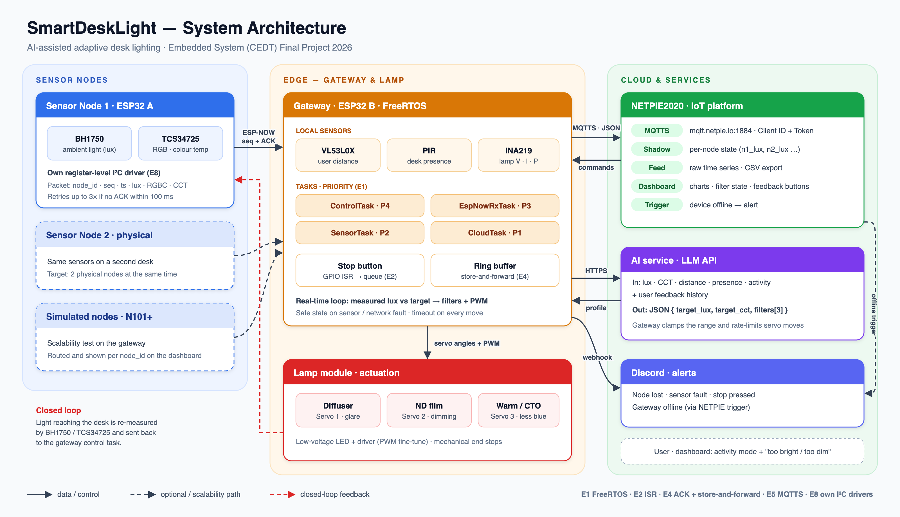

<div align="center">

# 💡 SmartDeskLight

### Light that adapts to how you work

An AI-assisted desk lamp that shapes light with servo-driven filters<br>and closes the loop on the lux that actually reaches your desk.

<sub>โคมไฟโต๊ะอัจฉริยะ ปรับสภาพแสงอัตโนมัติด้วย AI เพื่อความสบายตา</sub>

<br>

[](https://github.com/E3-Embed/SmartDeskLight/actions/workflows/build.yml)


[](LICENSE)

**[How it works](#how-it-works)** · **[Quick start](#quick-start)** · **[Docs](#documentation)** · **[Team](#team)**

</div>

<br>

<p align="center">
  
</p>

## Highlights

- **Shapes light, not just brightness** — diffuser, ND and warm/CTO filters flip in and out on three servos
- **Closed loop** — every change is re-measured on the desk (BH1750 lux, TCS34725 colour)
- **Learns your preference** — an LLM suggests a profile per activity and adapts to *too bright / too dim* feedback
- **Built to keep working** — ESP-NOW with ACK/retry, store-and-forward offline, rule-based fallback

## How it works

| | Step | What happens |
|:-:|---|---|
| 1 | **Sense** | The sensor node measures desk lux and colour; the gateway reads presence, distance and lamp power |
| 2 | **Decide** | The gateway sends context to the AI and receives a target lux, colour temperature and filter set |
| 3 | **Act** | FreeRTOS control task moves the filter servos and trims the LED with PWM |
| 4 | **Verify** | The new light is measured again and the loop corrects any error |

## Quick start

```bash
git clone https://github.com/E3-Embed/SmartDeskLight.git && cd SmartDeskLight
cp firmware/gateway/include/secrets.example.h firmware/gateway/include/secrets.h   # add your keys
pio run -d firmware/gateway -t upload
pio run -d firmware/sensor_node -t upload
```

Requires [PlatformIO](https://platformio.org/), two ESP32 boards and a NETPIE2020 device — see the docs below.

## Documentation

| | |
|---|---|
| 🔌 [Hardware](docs/hardware.md) | Bill of materials, pin map, power and safety |
| 📡 [Protocols](docs/protocols.md) | ESP-NOW packet, NETPIE topics, AI request / response |
| ⚙️ [Firmware](docs/firmware.md) | FreeRTOS tasks and Embedded Engineering Depth items |
| 🧪 [Testing](docs/testing.md) | Metrics, method and results |
| 📊 [Dashboard](dashboard/README.md) | NETPIE2020 device, dashboard and alerts setup |
| 🤝 [Contributing](CONTRIBUTING.md) | Branches, commit style, secrets policy |

## Team

| Member | Role |
|---|---|
| **รชาทัช บุญพัฒน์** · 6833230421 | System Architect & Integration |
| **ฐากูร นันตสุวรรณ** · 6833060021 | Embedded Developer — Sensor Node |
| **นรินธร ยางงาม** · 6833136121 | Embedded Developer — Gateway & Cloud |
| **ปุณยวีร์ พัฒนประดิษฐ์** · 6833170421 | UI/UX & Dashboard Developer |
| **กษิดิศ ประจงการ** · 6833008521 | Project Manager & Test Lead |

## Status

- [x] Proposal, architecture and CI — *30 Oct 2026*
- [ ] End-to-end data flow: node → gateway → cloud → dashboard — *20 Nov 2026*
- [ ] Final demo, report and video — *8 Dec 2026*

<br>

<div align="center">
<sub>Embedded System (CEDT) Final Project 2026 · Chulalongkorn University<br>
AI tools used: Claude (proposal editing, repo scaffold, docs, diagram), GitHub Copilot (commit messages) · <a href="LICENSE">MIT License</a></sub>
</div>
